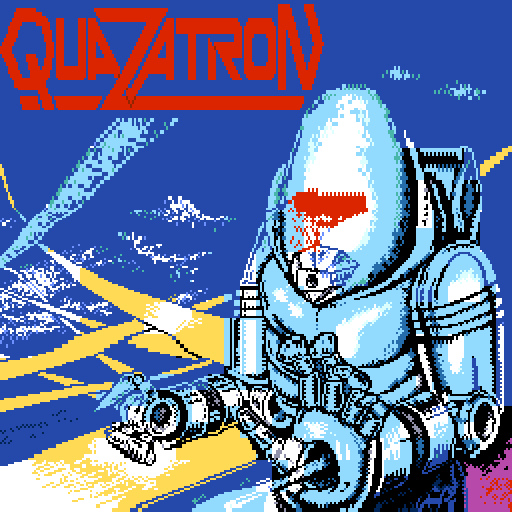
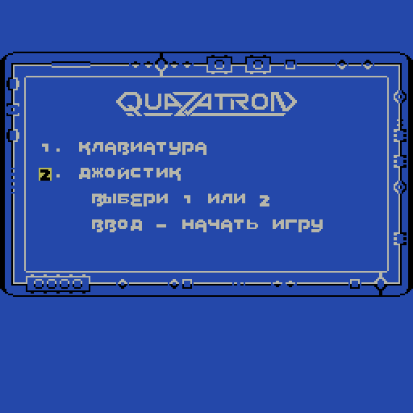
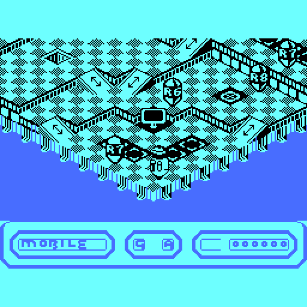
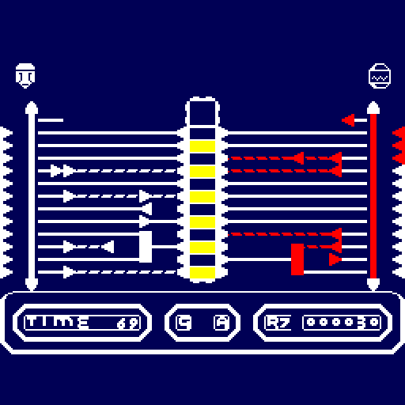
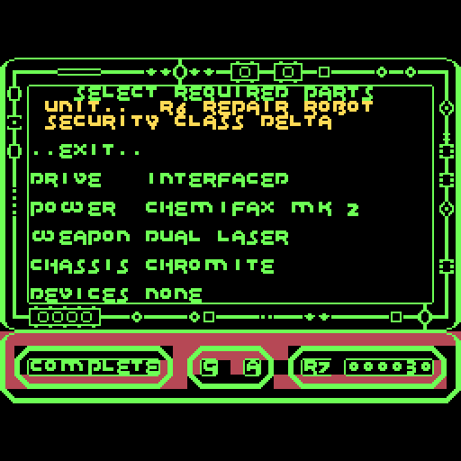
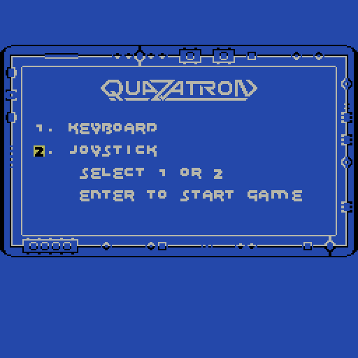

# Quazatron для Вектора-06Ц

Порт игры **Quazatron** (Steve Turner, Graftgold, Hewson Consultants, 1986, ZX Spectrum 48K) на обычный
**Вектор-06Ц**: КР580ВМ80А (i8080) 3 МГц, 64 КБ, без Z80-платы, без квазидиска и без AY, звук на ВИ53.
Код игры — перевод кода оригинала ZX с Z80 на i8080: логика сверена с ZX кадр в кадр, картинка — побайтно.
Цвет переложен с атрибутов ZX на палитру Вектора (свои цвета у каждого класса дроидов в мини-игре захвата),
есть 16-цветная заставка на весь экран и русская версия.

| Заставка | Меню | Игровое поле |
|---|---|---|
|  |  |  |

| Захват дроида | Выбор частей после захвата | Английская версия |
|---|---|---|
|  |  |  |

## Готовые образы

| Файл | Что это |
|---|---|
| [`rom/quazatron.r0m`](rom/quazatron.r0m) | русский, с 16-цветной заставкой (загрузочная картинка оригинала, перекрашенная под палитру Вектора); игра сжата и распаковывается по клавише |
| [`rom/quazatron-nosplash.r0m`](rom/quazatron-nosplash.r0m) | русский, без заставки — сразу меню |
| [`rom/quazatron-en.r0m`](rom/quazatron-en.r0m), [`rom/quazatron-en-nosplash.r0m`](rom/quazatron-en-nosplash.r0m) | то же на английском (язык оригинала) |

Образы `.r0m` — снимки памяти 64 КБ, которые грузятся **с адреса 0x0000**: так их берут ядро Vector-06C на
MiSTer и эмуляторы, понимающие этот формат. Игра занимает всю память, включая нулевую страницу.

## Управление

В меню: **1** — клавиатура, **2** — джойстик, **ВК** — начать игру.

| Клавиша | Действие |
|---|---|
| стрелки | движение |
| пробел | огонь; стоя на месте и удерживая — лифт, пульт или захват дроида |
| W (В) | режим окна состояния |
| P (П) | пауза (снимается огнём) |

**Джойстик «П»** (ВВ55 №2, порт 06h за портом 5 = 9Fh, читаются оба устройства): направления — движение,
огонь — огонь; стрелки и пробел при этом тоже работают. Покой джойстика замеряется при старте, нажатием
считается отклонение от него; если порт отдаёт мусор (меняются биты 4–5), считается, что ничего не нажато.
Порт 0Eh (джойстик «С») не читается.

**Режим бога**: на заставке игры нажать **F1 + F3** — игра начнётся с неубывающей энергией.

## Сборка

Код оригинала в репозиторий не входит: сборка берёт его из ленты ZX, которую нужно положить самому.

Нужны:
- лента `quazatron.tzx` (md5 `2153f5aeec7fb1439804114e59b0cdb3`) — в `orig/zx/`;
- ПЗУ ZX Spectrum 48K (нужны первые 0x530 байт, md5 `5ba5b72a…`): файл в переменной `ZXROM` или набор MAME
  `zx-stand/spectrum.zip`;
- Python 3 с Pillow и компилятор C (собирает упаковщик zx0 из `tools/zx0`);
- ассемблер [sjasmplus](https://github.com/z00m128/sjasmplus) 1.24 вложен в `tools/sjasmplus`, но это сборка
  **под macOS arm64**; на другой машине передайте свой: `SJASMPLUS=sjasmplus tools/build_roms.sh`.

```sh
tools/prepare_orig.sh        # лента -> orig/zx/quazatron_ram.bin (проверяет md5)
ZXROM=48.rom tools/build_roms.sh   # четыре образа -> rom/
```

Сборка воспроизводима: из чистого клона получаются побайтно те же файлы, что лежат в `rom/`.

По отдельности:

    port/build.sh                       # порт на Z80 (Вектор с Z80): build/port/quaz_z80.r0m
    port/build.sh --ru                  # то же, русский
    port/build.sh --i8080 [--ru] [--splash]   # i8080: build/port8080/quaz_8080[_ru][_splash].r0m

Порт сделан в два шага: сначала код ZX как есть на Векторе с Z80 (склейка с железом: экран, клавиатура,
прерывание, звук), затем перевод на i8080 (`tools/port8080.py`) с ручными заменами горячих мест —
прокрутка поля через кольцевой буфер, вывод полосы и экрана, заливка цвета, мини-игра захвата.
Аппаратная прокрутка Вектора не используется. Переводы строк — `port/ru/text.py`, таблица
«оригинал — перевод» — [docs/TRANSLATION.md](docs/TRANSLATION.md).

## Проверки

Стенды гоняют образы в эмуляторе [vector06js](https://github.com/svofski/vector06js) (Node.js) — путь в `V06JS`
(по умолчанию `~/projects/vector06js`).

```sh
tools/lockstep_all.sh               # Z80: 12 сценариев по 4000 кадров, логика и картинка против ZX на каждом кадре
I80=1 tools/lockstep_all.sh         # то же для i8080; RU=1 — русская сборка
node tools/xcheck80.js 5e7 [--ru]   # i8080 против Z80 команда в команду (50 млн команд)
node tools/joy_check.js build/port8080/quaz_8080.r0m   # джойстик «П»: старт огнём и все направления;
QZ_JOYDEAD=1 node tools/joy_check.js …                 # негативный контроль: порт молчит — обязан покраснеть
node tools/god_check.js build/port8080/quaz_8080.r0m god   # режим бога
node tools/splash_check.js build/port8080/quaz_8080_splash.r0m build/port8080/quaz_8080.r0m   # заставка
tools/tempo.sh                      # темп против ZX: мини-игра, ход, прокрутка
```

Стенд ZX — MAME (`zx-stand/`, нужен свой набор `spectrum`). План, этапы и числа — [docs/PLAN.md](docs/PLAN.md),
разбор оригинала — [docs/ANALYSIS.md](docs/ANALYSIS.md), [docs/MAP.md](docs/MAP.md), [docs/FUNCS.md](docs/FUNCS.md),
стенды — [docs/TESTS.md](docs/TESTS.md).

Темп (кадров ТВ на шаг; ZX → Вектор): мини-игра 4,06 → 5,97, ход 4,88 → 5,65, прокрутка 9,29 → 11,30.

## Что не входит

* лента и образ ОЗУ оригинала (`orig/zx/`), ПЗУ ZX, снимки MAME;
* демо прокрутки `demo/` собирается только с `orig/zx/state_play1100.bin` (снимок идущей игры со стенда MAME)
  и переводчиком из [kvalley-v06c](https://github.com/reqw41/kvalley-v06c).

## Права

Quazatron © 1986 Steve Turner / Graftgold, издатель Hewson Consultants. Порт некоммерческий; код и графика
оригинала принадлежат правообладателям, по их просьбе образы будут убраны. Заставка — загрузочная картинка
оригинала. Упаковщик zx0 — Einar Saukas (BSD-3, `tools/zx0/LICENSE`),
распаковщик для 8080 — Ivan Gorodetsky (ivagor).
